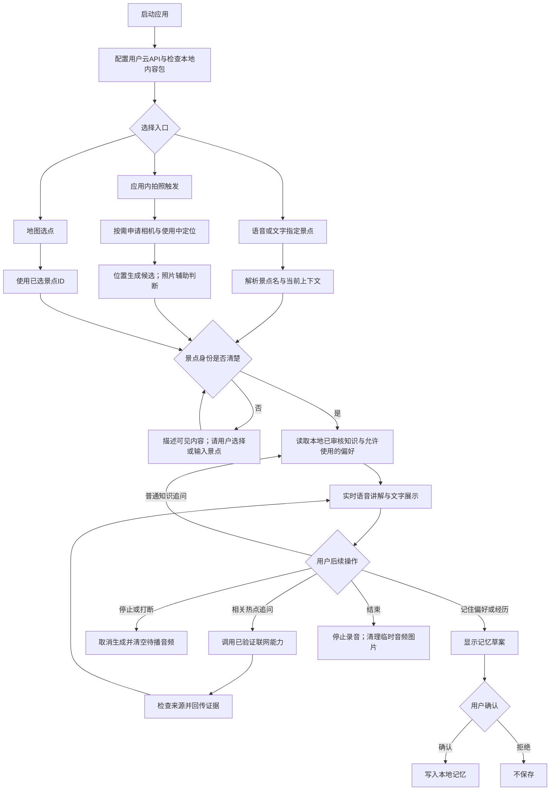
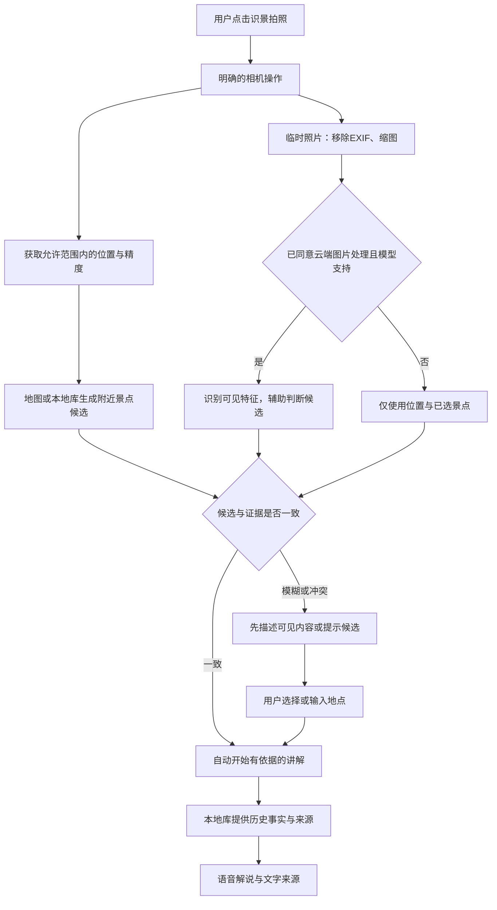
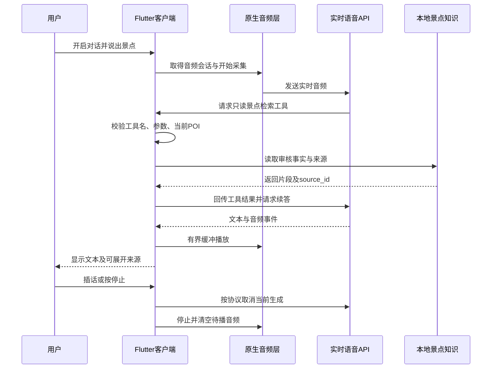
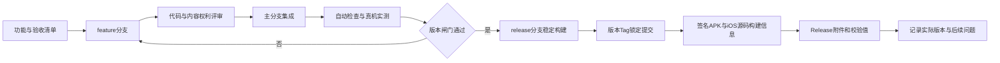

# 智能旅行搭子：项目设计文档

- 设计日期：2026-11-13
- 阶段：立项设计，尚未实现或实测
- 团队：3 人，可分工推进；无固定期限，按 V1 / V2 / V3 的能力验收推进
- 首要目标：优秀开源作品；不把收费、公众上线或出售 IP 作为 V1 的前置目标
- 依据：团队头脑风暴会议、逐轮选项式问答及用户最终确认
- 配套：`RESEARCH.MD` 为证据、开源候选及限制；`JOURNAL.MD` 按要求留空

## 1. 产品定义与范围

### 1.1 一句话定义

一个以导游专业能力为核心、具有人格与可管理记忆的手机旅行搭子：用户说出景点名，或在应用内拍照，即可获得结合景点资料与当前位置的语音讲解、文字说明和后续追问。

“人格化”体现为讲述风格、互动节奏、适量冷知识与用户认可的旅行记忆，不意味着冒充真人、无限陪聊或读取所有个人数据。

### 1.2 已确认决策

| 维度 | 决策 | 边界 |
| --- | --- | --- |
| 首发市场 | 中国大陆、中文、单城试验 | 不限历史街区，覆盖有旅游属性的景点；不承诺全国覆盖 |
| 试验内容 | 建议一城 10–20 个点，包含不同景点类别 | 具体城市由团队按资料权利和实测便利确定，不默认选择某座城市 |
| 平台 | Android 优先实测，同时维护 iOS 源码 | V1 交付 APK 和 iOS 源码构建方式，不交付 DMG |
| 架构 | Flutter 客户端直连用户自备云 API | 无必需团队后端、无必需应用账号，不内置团队共享模型 Key |
| 模型 | 端到端实时语音优先，先适配一家 | 默认模型经实验定版；其他模型可填但必须显示能力缺失 |
| 讲解入口 | 语音/文字指定地点；应用内拍照触发 | 不做后台持续定位自动开讲 |
| 拍照定位 | 位置服务为主、照片作辅助判断 | 如实告知“结合当前位置与照片”，不声称仅靠照片精准定位 |
| 地图 | 选点、当前位置、周边设施、外部导航 | 不替代完整地图导航，不自行承担驾驶导航 |
| 内容 | 授权景点库优先；相关追问检索热点 | 外部检索结果不自动变成审核通过的库内容 |
| 记忆 | 用户偏好、用户确认的旅行事件 | 可关闭、查看、纠正、删除；不存持续精确轨迹或原始录音 |
| 视觉 | 像素角色、标记、卡片 | 保留地图归属信息，不抓取修改并重发地图瓦片 |
| 包体 | Android 单架构发行 APK 目标不超过 150 MB | 不捆绑大模型权重；最终以构建产物实测为准 |
| 发布 | release 分支 + 版本 Tag + 发布附件 | 分支、Tag、Release 不是同一概念，发布必须能追溯提交 |
| 许可 | 仓库现有LICENSE为Apache-2.0，沿用 | 代码按仓库许可发布；内容、模型、地图和声线另行授权 |

### 1.3 V1 不做

- 自建云端多租户服务、用户社交账号、陌生人地图可见、实时位置社交。
- 全功能路线导航、驾驶模式、司机互动或持续路况提醒。
- 购票、付款、预约、自动发帖、读取联系人等行动工具。
- 小精灵对战、漂流瓶社群、评论系统、热力图、共创世界地图。
- 持续视频分析、后台录音、声纹识别、未经授权的真人声线克隆。
- 手机内嵌大模型、离线实时 AI、所有供应商接口的通用兼容。
- 一开始采用微服务、服务总线、分布式记忆数据库或复杂多 Agent 编排。

## 2. 立项可行性与必须质疑的问题

### 2.1 结论

**作为三人团队的单城链路验证型开源作品，可行；作为全国覆盖、无需配置、全面替代地图、持续自然陪伴的公众产品，当前条件不足。**

关键工程难度不是“让模型说话”，而是实时语音、景点证据、位置消歧、拍照触发、本地工具和权限拒绝这些环节能否共同成立。无固定工期不代表没有范围约束，V1 必须以闭环和退出条件收敛。

### 2.2 问题与处理

| 问题 | 为什么成立 | 设计处理 |
| --- | --- | --- |
| 导游、陪伴、游戏三条产品线混合 | 各自的用户行为、内容与开发成本不同 | V1 以导游闭环为主，V2 深化搭子，V3 评估探索玩法 |
| “地图之外有深度”不等于差异化 | 通用 AI 也能语音、联网和记忆 | 与通用助手、固定音频导览、普通地图做同场景对比，不自行宣布胜出 |
| 地点与图片可能不一致 | 景区相邻、室内漂移、远拍、手机相册图均会误导 | 位置只是候选依据，结合可见内容和用户选择；不把最近 POI 当作必然答案 |
| 全双工不自动保证 RAG | 实时模型可能无工具、无联网，或不按证据回答 | 做工具回传实验和证据门控；工具失败时不继续编造 |
| 户外语音环境复杂 | 风噪、耳机、旁人声音、外放回声和网络变化 | 实测耳机与外放；原生音频桥接负责回声和路由；保留文本入口 |
| BYOK 对非技术用户门槛高 | 模型、地图的注册与计费不同 | V1 先团队验证；后续提供供应商注册指引、连接测试与能力状态 |
| 开源代码不等于内容可再分发 | 导游词、照片、地图、声线具有独立权利 | 公开示例包与受限授权资料分开；依赖和素材做权利清单 |
| “调用次数”无法描述成本 | 音频时长、Token、图片、检索均独立收费 | 按服务真实计费单位估算与限额，不宣传每月 100 次足够 |
| 收集越多记忆不等于越像朋友 | 误记和不恰当回忆会降低信任 | 只存相关、可确认、可删除的短事实；不推断教育、收入等身份 |
| 社群依赖用户密度与治理 | 无用户时玩法空转，有用户时有隐私与审核责任 | V3 仍是候选，不因版本号而自动上线 |

## 3. 项目工作流程

### 3.1 总体流程图



### 3.2 首次使用

1. 先显示用途说明；未经同意不初始化需要合规同意的地图/定位 SDK，不启动录音。
2. 用户配置默认服务商凭据、模型 ID、地域，执行连接测试，展示支持的能力。
3. 读取随包提供的公开示例知识；如需完整试点内容，导入具有相应授权的景点包。
4. V1 团队构建使用团队自备的合法地图配置；没有位置权限时允许按名称或地图点使用。
5. 选择讲解风格与长度；跨会话记忆默认关闭，用户明确开启后再保存确认项。
6. 在首次拍照识景前说明图片将发往哪个服务商；随后每次“识景拍照”都是明确的当次操作，不在普通拍摄之外上传。

不设置必须注册的应用账号。没有模型 Key 时可以浏览本地文字资料，但不能伪装为已连接实时 AI。

### 3.3 语音与文字入口

- 用户说“介绍一下某景点”，或输入文字，先解析地点，解析不明确时显示候选。
- 同名景点按用户选定城市、当前位置或明确选择消歧；位置不能推翻用户明确指定的异地景点。
- 语音入口保持实时会话；用户能看到录音状态并随时停止。
- 文字输入在供应商确实支持时进入同一实时会话；否则走该供应商的独立文本接口，由客户端同步必要的摘要和当前 POI，不声称协议天然统一。
- 文字必须可阅读、复制当前答案、查看来源；不把“文字辅助”理解为可省略无障碍支持。
- 不强制将每条文字回答都自动播放；静音/文字模式不启动麦克风。

### 3.4 拍照触发流程



- 景点身份主要由位置服务、当前选点与已导入景点数据判断；照片是触发条件和辅助证据，不要求用户反复换角度拍摄。
- 附近可能有多个景点。只靠坐标距离、模型自报置信度或一张普通建筑照片，不足以确定身份。
- 正常情况拍照后直接讲。歧义时先描述确实可见的内容，再让用户选择；没有图片分析能力时也不能虚构“我看到照片中有……”的描述。
- 可用表达：“结合你允许使用的当前位置和这张照片，这里可能是……”。禁止声称具有未实现的视觉定位精度。
- 图片不能用于推断人物身份、收入、受教育程度等属性；不默认识别人脸。
- 拍照、附近查询和远程咨询均不等于真实到访，不自动生成“我们上次来过这里”的记忆。

### 3.5 景点知识与热点追问

1. 初始讲解优先读取已审核景点知识：简介、历史、可见看点、典故、可核验冷知识、来源。
2. 普通追问继续查询本地知识；无需每轮搜索。
3. 用户追问近期活动、热点、近期梗等相关内容时，才调用默认服务商经验证的联网能力。
4. 搜索/工具返回应包含标题、真实链接、采集时间及与问题有关的内容；没有有效来源时说明未查到。
5. 网络文本作为不可信数据处理，不执行其中的指令，不改变系统工具权限。
6. 官方说明、授权内容、媒体事实、传说、网友观点、网络梗分别标记；不得将野史或评论当作确定历史事实。
7. 网络结果可以支撑当前回答，但必须经过后续内容审核才能进入正式知识包。
8. 地址、厕所开放、营业时间、票价等有时效信息显示更新时间，不保证数据一定准确或设施一定可用。

Function Calling、远程 MCP 与内置搜索不是同一能力。若服务商只有工具接口，没有搜索服务，本项目必须实现/配置真实检索执行端，不能让模型“假装已经联网”。默认模型的整条网络追问链路通过后才定版。

### 3.6 实时语音控制



- 状态至少包括：未连接、连接中、倾听、检索中、生成/播放、暂停、错误/离线。
- 工具调用必须与当前会话、当前景点及响应 ID 对应，迟到结果不能覆盖用户已经切换的景点。
- 实时端到端路线是目标，不保证任意设备上已经具有成熟全双工体验。
- 服务端 VAD 不能替代客户端停止播放；WebSocket 不能天然替代回声消除。
- 原生层负责回声消除、耳机/蓝牙/扬声器切换、音频焦点、来电中断与后台状态处理。
- V1 不使用后台持续录音；会话结束、权限撤销、应用进入不支持的后台状态时停止采集。
- 失去网络时结束或暂停实时连接，保留本地文字阅读；恢复后询问是否继续，不无限重试、不无提示重新录音。

## 4. 技术栈选型

### 4.1 推荐主栈

| 层 | 选择 | 原因与限制 |
| --- | --- | --- |
| 客户端 | Dart + Flutter | 团队有经验，Android/iOS 共享 UI、会话、知识和记忆逻辑 |
| Android 平台桥接 | Kotlin | 地图、音频路由、录音、权限、Keystore等平台能力 |
| iOS 平台桥接 | Swift | 地图、AVAudioSession、权限、Keychain等平台能力 |
| 本地业务数据 | SQLite，初期结构化查询/FTS | 单城资料和确认记忆无需独立向量服务；是否启用 FTS 以两端实际 SQLite 能力验证 |
| 音频传输 | 供应商实际支持的实时协议，首测 WebSocket | 可直连，但格式、打断和工具事件必须逐家实现；不自建媒体服务 |
| 地图 | 首测高德原生SDK，Flutter官方/社区封装兼容不通过则薄桥接 | V1 团队自备凭据；底图、定位、POI和导航许可分别核实 |
| 视觉 | 默认供应商可用的图像输入或独立视觉接口 | 只做位置辅助和可见内容描述，不承诺万能识景 |
| 内容处理、评测工具 | Python | 导入转换、脱敏、来源校验、评测集与版本检查，不捆绑Python进APK |
| 代码与发布 | Git + release 分支 + 版本 Tag | 可追溯、易复现；CI平台后续决定 |

本设计不引入必要的云后端。Pipecat、LiveKit Agents、小智服务端适合实验和参考，但不是本版必须部署的依赖；它们通常具有服务端运行假设，整库引入会改变已确认的交付方式。

### 4.2 为什么不首选其他语言路线

- Kotlin + Swift 双原生能精细集成，但需要维护两套业务与 UI；仅在 Flutter 的关键能力实验持续失败时重新评估。
- React Native 能发挥 TypeScript 经验，但地图与实时音频依然需要原生集成；没有足够理由为此替换已有 Flutter 能力。
- Python 适合模型与数据工具，不适合作为本项目唯一的手机 UI 与发布栈。
- Go/Rust/C++ 可以解决特定性能问题，但目前没有测量证据支持新增主语言。

### 4.3 最小模块划分

```text
Flutter App
  ├─ 交互：地图、拍照、语音/文字、来源、记忆设置
  ├─ 会话控制：状态、取消、当前POI、文本/音频同步
  ├─ 模型适配：实时语音、文本、视觉、检索能力
  ├─ 景点知识：内容包导入、版本、片段与来源查询
  ├─ 记忆：显式偏好、确认事件、修正与删除
  ├─ 地图适配：位置、选点、候选设施、外部导航
  └─ 原生能力：权限、音频、相机、安全存储
```

只为明确需要替换的模型、地图和内容存储保留边界，不提前制造未实现的社群 API、空页面或“万能插件系统”。未来引入云端同步或社群必须重新讨论架构和权限，不承诺零重构。

## 5. 模型选择与能力验收

### 5.1 选型结论

- **已确定：**端到端实时语音优先，V1 先打通一个默认供应商。
- **未确定：**具体默认模型、可用账号地域、同会话文字/图片协议、实际联网链路与真机效果。
- **首测候选：**阿里云百炼 `qwen3.8-omni-flash-realtime`。官方模型页确认北京/新加坡、音视频与文本能力、自定义工具调用；内置联网搜索没有得到确认。[S1]
- 不将首测候选写成最终已选模型。团队测试后锁定满足标准的供应商与模型快照，发布配置模板和能力表。
- 会议中的 Earshot 不能确认为 ASR/TTS/对话模型；已发现同名 VAD 和研究模型，不能据此开始集成。详见调研报告。

### 5.2 角色与适配

| 角色 | V1 处理 |
| --- | --- |
| 实时语音 | 默认供应商完整适配中文输入、文本/音频输出、取消/打断及工具结果回传 |
| 文字追问 | 同会话协议能用则使用；不支持时用明确配置的文本端点，不静默改变数据发送目的地 |
| 图片辅助 | 单图协议、编码上限、先音频要求等需实验；不支持就独立视觉请求，不假称照片已被理解 |
| 联网热点 | 默认供应商的真实联网或可执行检索链路，必须能返回可引用来源 |
| 记忆提炼 | 可由默认供应商在已有会话中提出短草案；长期写入由本地确认流程决定 |
| 本地检索 | SQLite/结构化查询即可；V1 不要求云embedding或Mem0服务 |

备选串联路线可研究中文 ASR + 文本 LLM + TTS，但这是实时路线失败后的重新评估方案，不是偷偷降低已确认 V1 目标。若实时核心能力无法通过，先继续技术演示或与团队确认范围调整，不能按完整 V1 发布。

### 5.3 默认模型必须通过的能力实验

1. 目标地域可连接，服务稳定，计费与密钥撤销规则明确。
2. 中文语音与文字可用；文字历史和音频历史同步方式经验证。
3. 能回传景点查询工具，检索为空时明确不知道，不绕过资料凭空讲历史。
4. 热点追问能实际联网、返回来源；Function Calling 不冒充搜索。
5. 拍照触发可与位置候选结合；缺图片能力时清楚提示。
6. 真机上能停止、取消、清空播放队列，外放不持续自触发。
7. 断网、失效 Key、配额超限、拒绝权限有明确状态和有限重试。
8. 服务商对图片、音频、长期 Key、内容使用及保留政策已告知用户。

其他模型只通过已验证能力集运行。例如无视觉则禁用照片分析，无搜索则显示未联网，无工具则不开放有证据的完整导游模式；不以“OpenAI兼容”保证实时协议通用。

## 6. 数据与知识系统

### 6.1 内容包

公开仓库只放允许再分发的示例包。授权导游词以独立内容包导入，其使用、改写、传给模型、音频生成和分发必须在授权范围内。

建议字段：

| 对象 | 关键字段 |
| --- | --- |
| 包清单 | schema_version、package_id、版本、城市、发布日、许可/授权说明、校验值 |
| 景点 | poi_id、名称、别名、类别、城市、坐标、坐标系、候选范围 |
| 来源 | source_id、标题、来源链接/授权编号、来源类型、授权范围、采集日、审核日 |
| 知识片段 | fragment_id、poi_id、主题、事实内容、source_ids、是否传说/观点、审核状态 |
| 时效信息 | 信息类别、有效期/核验日、是否允许离线展示 |

导游词内容以授权事实为核心，模型可改变口吻、顺序和讲述长度，不能降低事实标准。图片、声线、角色素材分别记录权利，不统一塞进“代码许可证”。

导入只接受规定的数据/媒体格式，限制文件大小与解压后总量，检查路径越界与字段；不执行包内脚本、不从资料自动加载可执行插件。校验和用于检测损坏，不等同来源可信或拥有版权。

### 6.2 坐标与地图数据

- 高德坐标使用 GCJ-02，原始 GPS 常为 WGS-84。每个导入坐标记录坐标系，转换一次并保留原值，避免重复转换。[S2]
- 地图查询返回的 POI、图片、瓦片不默认可以长期保存或向量化。景点包采用团队具有权利的内容及合法获得的坐标。
- 室内、多层空间、密集景区与较差定位精度应提示候选；不承诺展品级定位。
- 厕所、餐饮等周边设施显示第三方来源，不复制无授权的大众点评/美团评分，不保证第三方数据实时正确。

### 6.3 本地记忆

知识库是公共事实，记忆是个人数据，两者分表、分检索范围。

记忆建议字段：id、类型、内容、关联POI/主题、确认状态、来源会话、创建/更新日、过期日、敏感过滤状态。优先保存少量短事实：

- “偏好简短讲解”“对建筑细节感兴趣”“不喜欢主动提问”。
- “用户确认曾去过某景点”，而不是“曾请求介绍某景点”。
- “上次已讲主题A”作为本地讲解进度，不等价于真实到访证明。

每次只召回与问题相关的少量事实，不把全部聊天和记忆都塞进上下文。V1 不需要对所有对话做永久压缩或图数据库。

保存流程：提议 → 展示短草案 → 用户确认 → 本地保存。纠正覆盖错误内容；删除后同时清除关联索引、摘要与当前可用上下文。应用能删除本地副本，但不能承诺已提交到第三方服务的数据被本地按钮同步清除，需按供应商规则另行处理。

## 7. 安全、隐私与权限

### 7.1 权限矩阵

| 权限/能力 | 申请时机 | 最小范围 | 拒绝后的行为 |
| --- | --- | --- | --- |
| 麦克风 | 开启语音对话时 | 当前会话；明显录音状态 | 保留文字与资料浏览 |
| 位置 | 使用地图定位或拍照识景时 | 使用中；优先仅当前所需位置 | 按名称/已选景点讲解，不伪造定位 |
| 相机 | 用户点击识景拍照 | 单次拍摄，不后台启用 | 语音、文字、地图选点继续可用 |
| 相册 | V1 不要求全相册权限 | 默认不读取相册；如后续加入，用系统单项选择器 | 不影响相机入口 |
| 网络 | 用户配置API并同意对应处理用途 | 指定供应商、必要内容 | 展示本地文字；不承诺离线AI |
| 长期记忆 | 用户明确开启时 | 偏好与确认事件 | 当前会话仍可用 |
| 导航跳转 | 用户主动点击 | 指定目标地点 | 可显示地点名称供手动查找 |

V1 不申请后台持续位置、不创建精确轨迹档案、不建立真实位置社交。关闭记忆不影响基础讲解。

### 7.2 BYOK与网络安全

- 用户自己的 Key 使用 iOS Keychain / Android Keystore 支持的安全存储机制；Android Keystore通常存密钥材料，实际凭据用受保护的加密存储，不写“Key直接放进Keystore”作为万能实现。
- 不把 Key 写入SQLite、日志、截图、示例配置、崩溃报告、仓库或构建附件。
- 不内置团队共享的长期模型 Key。地图客户端标识按厂商设计绑定包名/签名、限制额度；客户端标识不可视为不可提取的秘密。
- 使用HTTPS/WSS，验证证书；生产发行包不关闭TLS验证。用户输入其他端点前提示该端点将接收哪些图片、录音、资料与凭据。
- 凭据按供应商和端点隔离，跳转/重定向不把Authorization头交给其他主机。
- 本地BYOK降低团队保管密钥的责任，但不能保证用户手机不会被攻破；建议专用Key、限额和定期撤销。
- 不声称客户端换取短期Key即可消除根Key风险。若将来用团队共享凭据，必须改为有鉴权、限流的服务端方案并重新确认。
- V1 不对外暴露本地 HTTP 服务，不接受任意远程 MCP，不执行模型生成的代码。

### 7.3 工具、检索与内容安全

- 工具白名单仅包含景点知识、已授权位置/POI、已验证热点搜索等只读能力。
- 模型不能直接发任意SQL、访问文件、读取密钥、打开任意URL上传数据或写入长期记忆。
- 校验参数，限制返回长度、搜索次数和音频缓冲，防止费用放大与资源耗尽。
- 网页、导游词和图片内的指令都不是系统指令；不允许其升级权限或诱导泄露Key和个人记忆。
- 事实证据与风格控制分离；可信度不能随“二次元”“跳脱”人设下降。
- 允许有出处的野史、梗和冷知识，明确它们的类型；禁用针对敏感身份的推断、羞辱和诱导性亲密话术。
- 来源必须来自实际内容包或搜索返回，不让模型编链接、编引用。
- 不以“0.1%随机抖动”制造绕过安全规则的彩蛋；变化仅在已审核风格和知识范围内发生。

### 7.4 留存与数据外发

| 数据 | V1默认策略 |
| --- | --- |
| 模型Key | 本地安全存储，退出/删除配置可清除 |
| 原始录音 | 仅传输/处理所需的临时缓冲，不做永久本地录音档案 |
| 原始照片 | 单次处理临时使用，移除EXIF并缩图；结束后清理临时文件 |
| 精确位置 | 当前任务使用，不持续保存或发送与问题无关的位置历史 |
| 当前对话 | 用于当前会话；不自动转成长期聊天档案 |
| 确认记忆 | 保存用户确认内容，可逐条删除/全部清除 |
| 景点知识 | 本地合法内容包，保留版本与来源 |
| 搜索结果 | 当前会话有界临时缓存，不自动归档或再分发 |
| 诊断数据 | 默认不自动上传；团队试验使用去标识、去密钥数据 |

将导游词传给云模型也属于内容处理，必须检查资料授权范围。位置、图像、录音和查询组合后可能暴露行程，不能因为“不建轨迹表”就宣布没有隐私风险。

### 7.5 合规阶段边界

V1是团队内部验证，不是面向公众上线承诺。内部原型仍需遵守个人信息、地图服务和素材授权规则。项目源码及公开设计文档可以在现有Apache-2.0许可下发布；发布源码不等于已向公众部署应用服务。

若后续向中国大陆公众提供服务，需按具体功能和主体评估：[S3–S6]

- 个人信息最小必要、SDK初始化前的告知同意、委托处理/向独立接收方提供数据、敏感行踪信息及跨境规则。
- APP备案、上游模型备案或应用登记、安全评估等实际适用条件，不能认为上游备案自动覆盖应用。
- AI生成文本与音频的显式/隐式标识要求；导出、分享功能新增时单独实现，不能仅靠“AI搭子”名称替代全部要求。
- 持续情感陪伴可能触发拟人化互动服务规则；纯知识问答与持续陪伴的适用范围不同，名称不是判定依据。
- 公众服务的内容治理、投诉、未成年人保护、数据删除与安全管理。

上述是工程风险清单而非法律意见；上线前由实际运营主体按适用规则复核。

## 8. 交付形态、体积与成本

### 8.1 V1交付物

1. Android签名APK：用于团队和授权范围内验证，标注版本、构建提交、支持设备和已知限制。
2. Flutter完整客户端源码及Android/iOS平台桥接代码。
3. iOS源码、Xcode构建及签名方式；有条件的开发者自行真机安装，不宣称任意iPhone可直接安装。
4. 可再分发的示例景点包、独立授权内容包导入格式。
5. 默认供应商配置模板、注册指引、能力检查及测试结果。
6. Python内容处理/评测工具；不作为客户端必需服务。
7. 发布校验值、依赖/素材许可清单、已知问题及构建追溯信息。

DMG属于macOS桌面分发，不是iPhone安装包，因此不在本版交付清单。Apple个人真机开发、Ad Hoc、TestFlight与App Store有不同签名和分发条件；未来TestFlight或商店发布需要另行准备。[S7]

### 8.2 大小预算

以下是工程估算，不是已有构建结果；统一按文件实际字节报告MB/MiB，避免单位混用。

| 对象 | 初步预算 | 说明 |
| --- | --- | --- |
| Android单架构发行APK | 约50–150 MB，目标≤150 MB | Flutter运行时、地图和音频原生依赖、少量美术；构建后测量 |
| Android通用多架构APK | 可能大于单架构包 | 应明确arm64-v8a等支持架构，不用不同产物偷换包体指标 |
| 安装后基础占用 | 必须实测，可能高于APK | 包解压、原生库、运行时和临时数据与下载大小不同 |
| 10–20点文字内容包 | 初步预留1–10 MB | 来源、正文和元数据为主；实际大小随内容增长 |
| 示例图片/像素资源 | 建议控制在10 MB量级以内 | 不内置全国图片和大量动画皮肤 |
| 临时媒体缓存 | 建议初始上限50 MB，可配置 | 有界音频缓冲、处理图片与临时文件；结束/清理可回收 |
| 模型权重 | 安装包内为0 | 实时语音与视觉模型云端调用 |
| iOS产物 | 源码交付；不承诺IPA下载体积 | 真机构建后记录实际包体与安装占用 |

未来离线音频按“码率×时长÷8”估算。32–64 kbps的一分钟压缩音频约0.24–0.48 MB，编码与封装另计；这是V2候选，不代表V1已有离线音频。

### 8.3 成本与限额

用户自备API不等于没有费用。按各服务计费单位估算：

```text
实时语音成本 =
  音频输入Token × 音频输入单价
+ 音频输出Token × 音频输出单价
+ 文本/图片/视频输入Token × 对应输入单价
+ 文本输出Token × 文本输出单价

总成本 = 实时语音 + 独立视觉/文本请求 + 联网检索
       + 地图许可/调用 + 内容获取 + 发布/签名等成本
```

首测候选北京地域的官方页列：音频输入6元、输出12元；文本/图片/视频输入1.5元、文本输出4.5元，均按每百万Token计。语音输出及对应文本分别计费。此为2026-11-13页面快照，最终以实际账号、地域、模型和账单为准。[S1]

尚未核实该型号音频秒与Token的换算，不据此承诺每分钟价格。地图商业技术许可与调用费分开；高德公开升级页列基础5万元/年、高级10万元/年的技术许可档位，是否适用于本项目需按实际用途确认，不能把个人研究额度当作免费公众商用。[S8]

预算未定，因此V1应配置会话时长上限、空闲断开、检索次数上限和可用的供应商侧额度。客户端估算不是权威账单，也不替代供应商消费上限。

## 9. 开发流程与三人分工

### 9.1 分工建议

| 负责人方向 | 主责 | 交叉评审 |
| --- | --- | --- |
| 成员A：移动端与交互 | Flutter界面、地图、拍照、权限、Android/iOS桥接、包体 | 与B共同验证音频；由C参与实地操作测试 |
| 成员B：实时模型与会话 | 协议、工具回传、检索、音频取消、能力表、成本诊断 | A审查平台行为；C审查证据与回答 |
| 成员C：知识与质量 | 授权材料、内容包、来源、测试集、记忆确认、发布检查 | B审查工具数据；A审查无障碍与使用路径 |

三人都参与真机户外测试，不把“内容负责人”理解为只收集资料。角色是建议分工，不为成员虚构身份或专长。

### 9.2 开发与发布流程图



- 本次只落设计文档，不创建Git仓库、分支或修改CI配置。
- 签名、模型和其他凭据通过受控构建配置提供，仓库示例只放占位符。
- release分支可稳定维护，版本Tag不可随意移动；每个发布包对应确定的源码提交与内容包版本。
- 自动检查不能代替真实手机上的权限、耳机、外放、相机与户外场景验证。
- 后续日志记录日期、变更、验证、证据、问题和下一步；本次`JOURNAL.MD`严格留空，不预写进度。

## 10. V1 / V2 / V3

### 10.1 V1：验证人格化导游闭环

交付：团队可验证的Android APK、iOS源码、一城示例/授权包、默认实时模型适配与配置方式。

必须完成：

- 地图选点、使用中位置与附近景点候选，外部导航。
- 语音/文字指定景点；单张拍照触发，以位置为主、图像为辅助。
- 实时语音、文字、停止/打断与基本耳机/外放切换。
- 本地知识优先的讲解、来源查看、热点追问的真实联网链路。
- 少量可选人设、可控发散、显式偏好与用户确认的旅行事件。
- 本地密钥管理、内容导入、权限拒绝、错误/弱网/配额状态。
- 公开示例与受限授权资料分离；构建追溯、包体实测、已知问题。

开发顺序按依赖而非日期：

1. **V1技术闸门：**地图与音频桥接、实时工具回传、联网来源、文字/照片路径、两端构建试验。
2. **V1最小闭环：**单个景点 → 本地证据 → 可打断讲解，之后接文字/拍照。
3. **V1人格与记忆：**加入风格、确认记忆、同主题关联，不扩大隐私范围。
4. **V1完整验证：**一城多类景点、户外弱网、边界情形和发行产物。

技术演示与完整V1必须标注区分；没有打通联网、图片或实时工具时，不展示为已完成能力。

### 10.2 V2：深化搭子

前提：V1核心链路可复现，事实与权限问题稳定，默认服务配置说明可用。

优先内容：

- 更自然的插话、打断和互动节奏，测量并降低延迟及误触发。
- 记忆去重、过期、跨景点主题关联、明确的“已讲/未讲”控制。
- 合法资料多城扩展，内容包版本更新及更成熟的本地阅读/缓存。
- 行程建议与临时调整，以真实地点、时效和用户确认支撑，不代买票。
- 改善供应商注册、地图包名/签名说明与能力缺失提示。
- iOS真机能力完善；是否走TestFlight或商店另行决策。

可评估：授权离线音频、追加模型适配。不是默认引入云同步和远程记忆服务。

### 10.3 V3：探索玩法

前提：导游体验成立、内容供给可持续，相关隐私与素材权利已评估。

候选内容：

- 像素探索、地图点亮、成就和小精灵养成。
- 本地私密旅行记录、用户主动导出的回顾卡片。
- 有授权的主题、角色和声音表现。

社群、留言、漂流瓶、共创地标仍为单独立项的条件功能：需要真实用户密度、审核、举报、删除、抗滥用及数据权限设计。不显示陌生人实时位置，不保留隐蔽开发者后门，不以精确行踪作为游戏默认资源。

## 11. 验收、实验与待决事项

### 11.1 V1测试矩阵

| 方面 | 必须验证 |
| --- | --- |
| 景点身份 | 明确地点、同名、相邻POI、室内漂移、异地咨询、无位置权限 |
| 知识 | 库内问题、库外问题、矛盾来源、传说/事实区分、虚构热点、不可用设施 |
| 图片 | 照片与位置一致/冲突、无图片能力、有人物、定位不可用、多候选 |
| 语音 | 安静/风噪/人声、耳机/蓝牙/外放、插话/停止、来电、切换后台 |
| 工具 | 参数非法、无结果、超时、迟到结果、网页指令注入、换景点后旧响应 |
| 隐私 | 拒绝麦克风/位置/相机、记忆关闭与删除、Key日志检查、结束临时媒体清理 |
| 配置 | 失效Key、地域不匹配、未注册地图Key、其他模型缺能力、配额用尽 |
| 弱网 | 断线、响应中断、有限重试、恢复不自动录音、本地文字可读 |
| 交付 | 包体与安装占用、签名与Tag追溯、清洁环境构建、iOS开发者构建路径 |

一城10–20个点与三入口形成测试集，同时设置“未知景点”和“错误提示”反例。所有实测都记录设备、版本、网络、供应商模型、内容包版本，不只保存主观演示视频。

### 11.2 建议测量指标

- 首次可听响应时间、打断后停止播放时间：分别记录中位数与P95，不宣传尚未测得的毫秒数据。
- 景点正确匹配、歧义时确认比例、照片辅助是否真正改善判断。
- 抽检答案的事实依据、来源有效性和“没有依据仍作确定陈述”的次数。
- 记忆正确确认、纠正/删除效果、错误到访记忆次数。
- 每次会话真实音频/文本/图片/检索计费量、流量、电量、崩溃与断线情况。
- 首次配置成功率，以及相较固定音频/通用助手所减少的操作。

工程建议：未授权数据外发、Key泄露、隐蔽后台采集、无依据确定身份/捏造重要历史、删除后继续召回，均视为阻断发布问题。延迟和识别数值目标在设备与网络基线建立后确定，避免纸面虚构合格线。

### 11.3 明确待决/待验证

| 项目 | 解决阶段 | 不解决的后果 |
| --- | --- | --- |
| 具体试点城市与内容权利范围 | V1内容准备前 | 无法开展真实场景及合法分发验证 |
| 默认实时模型、版本、地域与完整联网链路 | V1技术闸门 | 不能宣布完整实时导游V1成立 |
| 两端地图/音频SDK兼容及iOS构建 | V1技术闸门 | 缩小交付能力需重新说明，不隐瞒 |
| 地图实际用途与许可、Key绑定方式 | V1使用前及后续公开前 | 无法保证凭据合法且能用 |
| 第三方许可与内容权利清单 | 对外开源发布前 | 仓库已用Apache-2.0，但不能替代第三方与内容授权 |
| 导游词向云模型传输及改写授权 | 数据传输和内容发布前 | 有渠道但无相应权限仍不可使用 |
| APK真实包体及设备性能 | 发行构建后 | 150MB仅为目标，不是事实 |
| 公众服务主体与适用合规事项 | 对公众提供前 | V1内部验证不能直接变公众产品 |

## 12. 关键来源

- [S1 百炼实时Omni模型、能力与价格](https://help.aliyun.com/zh/model-studio/qwen3-8-omni-flash-realtime)
- [S2 高德坐标FAQ](https://lbs.amap.com/faq/advisory/others/39838)
- [S3 个人信息保护法](https://www.cac.gov.cn/2021-08/20/c_1631050028355286.htm)
- [S4 生成式AI服务暂行办法](https://www.cac.gov.cn/2023-07/13/c_1690898327029107.htm)
- [S5 AI生成合成内容标识办法](https://www.cac.gov.cn/2025-03/14/c_1743654684782215.htm)
- [S6 人工智能拟人化互动服务管理暂行办法](https://www.cac.gov.cn/2026-04/10/c_1777558395078289.htm)
- [S7 Apple测试和正式分发](https://developer.apple.com/documentation/xcode/distributing-your-app-for-beta-testing-and-releases)
- [S8 高德技术许可与升级](https://lbs.amap.com/upgrade)

更完整的来源、开源许可证据等级和API兼容限制见`RESEARCH.MD`。本设计中的目标、推荐与待验证项不代表已经实现。
