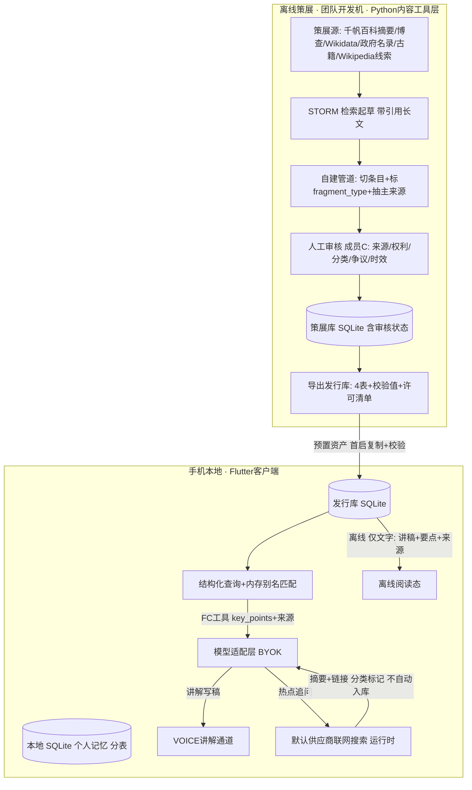
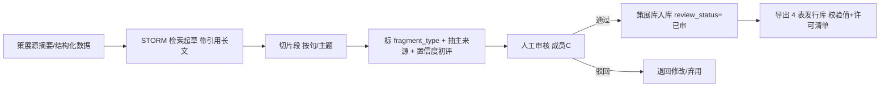

# 知识库模块架构设计（KNOWLEDGE.MD）

- 设计日期：2026-11-18
- 阶段：架构讨论共识，**尚未实现或实测**
- 依据：handoff 续作讨论、三路网络调研（导游知识库项目与杭州数据源、运行时搜索注入可行性、知乎开放平台核实）、逐轮选项式问答与用户确认（Q17–Q25；2026-11-18 续轮完成表结构精简定稿）
- 与 DESIGN.MD 的关系：本文档细化知识库/内容系统。**DESIGN.MD 本轮不修改**；需并入的变更见 §11，经用户复核后另行提交。与 VOICE.MD 衔接：讲解通道写稿取本文档的知识片段（VOICE D3）。
- 证据等级沿用 RESEARCH.MD §2.2：A=官方文档原文，B=搜索摘要/第三方，C=工程估算，未核实=集成前补证。

## 1. 决策记录（用户已确认）

| # | 决策 | 内容 |
| --- | --- | --- |
| K1 | 架构 | **本地审核库 + 搜索辅助策展**。运行时本地审核片段为骨 + 热点时效才搜索（DESIGN 证据模型不动）；搜索退到策展阶段当起草助手。纯运行时搜索注入（无库）已被事实证伪：无合法全文 API。 |
| K2 | 检索 | V1 SQLite 结构化查询（place_id + fragment_type）+ 别名内存匹配；**不启用 FTS/R\*Tree**（K17），无 embedding/向量服务；V2 多城扩展再评估（DESIGN §5.2 现行） |
| K3 | 权利边界 | 事实抽取 + 原创表达；逐源规则见 §6 |
| K4 | 试点 | 杭州 working example，三大遗产锚点（西湖文化景观/良渚古城/大运河）+ 类别覆盖；定版待资料权利核查 + 实测便利（DESIGN 城市未定版） |
| K5 | Schema | **发行库 4 表 30 列**（§4.1），策展库为其超集（§4.4）；取代原「五表 + 补缺口」 |
| K6 | 策展工具 | **STORM 起草引擎**（Python 内容工具层，许可/依赖待核）+ 自建「长文→片段→分类→抽来源→人审入库」管道 |
| K7 | 策展源 | 千帆百科摘要 API（0.01 元/次）+ 博查（0.036 元/次）+ Wikidata/政府名录/古籍 + Wikipedia 摘要（仅线索）；团队承担成本，非用户 BYOK |
| K8 | 内容分类 | 12 层（§5）；史实/传说分类标记 + 争议标来源 |
| K9 | 审核 | 成员 C 主责（DESIGN §9.1）；清单：来源核验/权利检查/分类/争议标记/时效核验日 |
| K10 | 运行时接口 | FC 工具返回讲稿/要点 + 来源标题/链接/署名（衔接 VOICE D2/D3）；热点追问走默认供应商 BYOK 搜索（DESIGN §3.5） |
| K11 | 双库分离 | **策展库（离线，含审核流程）与发行库（手机端，只装已审内容）两套 schema**。发行库不可修改审核状态，编辑元数据一律留在策展侧；唯一例外是 `place_alias.confidence`（K18），只读随包下发 |
| K12 | 版本与交付 | **单生效包**：无 `package_uid`/`is_active`/复合外键，导入即整库替换；**预置 SQLite 资产**随 APK 打包（构建期由策展库导出，首启复制到 app data），V1 不做运行期导入 UI |
| K13 | 精简 | 发行库由 7 表 71 列压到 4 表 30 列；合并 `topic`+`content_type`→`fragment_type`，删双语列、代理键、坐标逐行标记（导入归一化）、`source_type` |
| K14 | 时效并入片段 | 删除 `timeliness` 表：时效信息作为 `fragment_type='practical'` 的条目，自带 `valid_to`/`verified_at`；**一条 practical 只讲一个话题** |
| K15 | 来源内联 | 不建 `source` 表；`fragment` 内联 `source_title/source_url/attribution/allow_cloud_llm` 四列，**一条讲稿引一个主源**（策展侧可多源，导出时取主源） |
| K16 | 讲稿用途 | 标准/精简讲稿**仅作离线文字降级**（离线仅文字，不接系统 TTS，无自由问答）；**讲稿不进联网 prompt**，联网讲解只喂 `key_points` + 来源 |
| K17 | 检索结构 | 10–20 个景点规模下不建 `fragment_fts`/`place_alias_fts`/`place_rtree` 及同步触发器；别名启动时载入内存哈希表，附近候选全表扫描。扩到数百点位再评估 |
| K18 | 别名置信度 | `place_alias` 增加 `confidence`（`auto`/`review`/`manual`），随发行库下发；`review` 行分发前须人工确认，端上只读不改写。这是 K11「只装已审内容」的显式例外 |

## 2. 架构总览



**两条搜索链路严格区分**：
- 策展搜索（离线，团队工具，团队付费）：起草片段，人审后入库。
- 运行时热点搜索（在线，用户 BYOK，默认供应商）：只补时效/热点，摘要 + 链接 + 分类标记，**不自动变成已审核库内容**（DESIGN §1.2/§3.5）。

## 3. 部署形态（手机本地，非云端数据库）

- **发行库 = 手机本地 SQLite**（Flutter 客户端内），构建期由策展库导出、随 APK 预置。**无团队云端数据库**（DESIGN §1.2「无必需团队后端、无必需应用账号」）。
- 云端调用仅限三类，均非知识库存储：
  1. 模型 API（实时语音/文本/视觉，用户 BYOK 自备 Key，直连供应商）；
  2. 热点追问搜索（默认供应商联网能力）；
  3. 地图 SDK（高德，团队自备凭据）。
- **策展工具（STORM + 搜索 API）在团队开发机运行**，产出内容包；不在用户手机、不在云端运行时。
- 为什么本地：离线弱网可读（DESIGN §3.6/§11.1 户外核心场景）、隐私（个人记忆本地不上云）、无后端运维、可审计（source_id + 版本快照）、包体可控（DESIGN §8.2 内容包 1–10 MB）。
- 内容包分发（K12）：构建期由策展库导出为 SQLite 资产随 APK 打包，首启复制到 app data；独立授权包用同格式文件替换生效。导入/替换只接受规定格式，限制大小，检查路径越界与字段，**不执行包内脚本**（DESIGN §6.1）。
- **策展库独立存在**（§4.4），只跑在团队开发机，含审核状态、原始快照、草稿与多源关联；它是发行库的上游，不是运行期组件。
- 个人记忆也在本地 SQLite，与知识库**分表、分检索范围**（DESIGN §6.3）；知识库是公共事实，记忆是个人数据。

## 4. 数据模型（发行库 4 表 30 列，2026-11-18 定稿；2026-11-19 v2 增 `place_alias.confidence`）

> 本节取代 K5 原先的「五表 + 补缺口」。依据 K11（双库分离）、K12（单生效包 + 预置资产）、K13（精简）、K14（时效并入）、K15（来源内联）、K17（不启用 FTS）。

### 4.1 发行库 DDL（手机端，随 APK 预置）

```sql
PRAGMA foreign_keys = ON;
PRAGMA user_version = 2;                 -- 发行库结构版本；v2 增 place_alias.confidence

-- 1. 包清单：单行，换包即整库替换
CREATE TABLE content_package (
  package_id      TEXT PRIMARY KEY,      -- 包标识 hz-core
  version         TEXT NOT NULL,         -- 包版本 1.2.0
  city_code       TEXT NOT NULL,         -- 城市行政区划码 330100
  published_at    TEXT NOT NULL,         -- 内容发布日期 ISO-8601
  license_note    TEXT NOT NULL,         -- 包级授权说明
  checksum_sha256 TEXT NOT NULL          -- 包完整性校验值
);

-- 2. 点位：自引用三层 景区→景点→点位
CREATE TABLE place (
  place_id           TEXT PRIMARY KEY,   -- 点位ID leifeng-pagoda
  parent_id          TEXT REFERENCES place(place_id) ON DELETE CASCADE,
                                         -- 上级点位ID，顶层为 NULL
  level              TEXT NOT NULL
                       CHECK (level IN ('area','site','point')),
                                         -- area 景区 / site 景点 / point 具体点位
  name               TEXT NOT NULL,      -- 名称
  lat                REAL NOT NULL,      -- 纬度（已归一为 GCJ-02）
  lon                REAL NOT NULL,      -- 经度（已归一为 GCJ-02）
  candidate_radius_m INTEGER NOT NULL
                       CHECK (candidate_radius_m >= 0)
                                         -- 候选判定半径（米）
);

-- 3. 别名：语音「名字→点位」的反向索引
CREATE TABLE place_alias (
  place_id   TEXT NOT NULL REFERENCES place(place_id) ON DELETE CASCADE,
                                         -- 点位ID
  alias      TEXT NOT NULL,              -- 别名 黄妃塔 / leifengta
  confidence TEXT NOT NULL DEFAULT 'auto'
               CHECK (confidence IN ('auto','review','manual')),
                                         -- auto 自动生成 / review 待复核 / manual 人工指定
  PRIMARY KEY (place_id, alias)
);
CREATE UNIQUE INDEX ux_place_alias ON place_alias(alias);
                                         -- 全局唯一：导入期暴露「一词多指」冲突

-- 4. 讲解条目：讲稿 + 要点 + 来源 + 时效
CREATE TABLE fragment (
  fragment_id     TEXT PRIMARY KEY,      -- 条目ID f-leifeng-legend-001
  place_id        TEXT NOT NULL REFERENCES place(place_id) ON DELETE CASCADE,
                                         -- 所属点位ID
  title           TEXT NOT NULL,         -- 标题 白蛇传说
  fragment_type   TEXT NOT NULL
                    CHECK (fragment_type IN
                      ('fact','legend','poetry','highlight','trivia','practical','spatial')),
                                         -- 史实/传说/诗文/看点/冷知识/实用/方位
  content         TEXT NOT NULL,         -- 标准讲解词
  content_short   TEXT,                  -- 精简讲解词（导出时抽取首两句）
  key_points      TEXT,                  -- 关键知识点 JSON 数组，联网时唯一事实输入
  keywords        TEXT,                  -- 关键词标签 JSON 数组
  valid_to        TEXT,                  -- 有效期截止，仅 practical 有值
  verified_at     TEXT,                  -- 最近核验日，仅 practical 有值
  source_title    TEXT NOT NULL,         -- 来源名称
  source_url      TEXT,                  -- 来源链接（古籍可为 NULL）
  attribution     TEXT NOT NULL,         -- 署名或授权编号
  allow_cloud_llm INTEGER NOT NULL DEFAULT 0
                    CHECK (allow_cloud_llm IN (0,1)),
                                         -- 是否允许把本条发给云端模型
  CHECK (fragment_type = 'practical'
         OR (valid_to IS NULL AND verified_at IS NULL))
);
CREATE INDEX idx_fragment_place ON fragment(place_id);
```

### 4.2 相对 DESIGN §6.1 的变化

| 变动 | 说明 |
| --- | --- |
| 五表 → 四表 | 删 `timeliness`（并入 `fragment` 的 `practical`）；不建独立 `source` 表 |
| `poi` → `place` | 加 `parent_id` + `level`，支持 景区→景点→点位 三层（K13） |
| 别名表 7 列 → 3 列 | 自然主键 + 全局唯一索引，删代理键/类型/首选标记；保留 `confidence`（K18） |
| 删 `schema_version` 列 | 改用 `PRAGMA user_version` |
| 删坐标系逐行标记 | 导入时归一为 GCJ-02；原值留策展库（§4.4） |
| 删双语列 | V1 中文单语，`name_en`/`lang` 删除 |
| 删审核/生成溯源 | 审核流程与生成溯源留在策展库；别名置信度例外随包下发（K18） |
| 删 FTS / R*Tree | 10–20 点位规模不需要（K17） |

### 4.3 三条硬约束

1. **`practical` 一条一话题**：开放时间、票价、交通、厕所各一条，不得合并在一条里，否则 `valid_to` 只能填最早日期。
2. **易变信息只出现在 `practical`**：票价、预约、临时闭馆不许写进 `fact`/`legend` 讲稿，涨价时没人会去改历史条目。
3. **过期不隐藏，只标注**：`valid_to` 已过时 UI 显示「该信息核验于 …，可能已变更」，不静默删除。

DDL 的复合 `CHECK` 已强制第 1 条的存储形态；第 2、3 条属策展规范与 UI 约定。

### 4.4 策展库（离线）＝ 发行库的超集

发行库是策展库的**投影**，不是另一套独立维护的结构。

| 对象 | 发行库 | 策展库增量 |
| --- | --- | --- |
| `place` | 7 列 | + `category` 类别、`address` 地址、`coord_system` 原始坐标系、`src_lat`/`src_lon` 原始坐标 |
| `place_alias` | 3 列 | 无增量（`confidence` 随包下发，K18） |
| `fragment` | 14 列 | + `review_status`、`confidence`、`authoring`、`model_ref`、`created_at`、`updated_at` |
| `source`（策展库独有） | — | `source_id, title, url, license_code, attribution, source_type, collected_at, reviewer, allow_rewrite, allow_tts, allow_redistribute, allow_cloud_llm` |
| `fragment_source`（策展库独有） | — | `fragment_id, source_id, locator, quote`；支持一稿多源 |
| `source_snapshot` | — | `snapshot_id, source_id, path, sha256, fetched_at, http_status` |
| `draft` | — | `draft_id, place_id, fragment_type, content, model_ref, prompt_version, storm_run_id, created_at` |
| `review_event` | — | `review_id, fragment_id, reviewer, action, note, at` |

**导出步骤（发行库由此生成）**

1. 片段：`review_status='approved'` 且主来源 `allow_redistribute=1`。
2. 来源内联：取主来源的 `title/url/attribution/allow_cloud_llm` 四列写入 `fragment`。
3. 坐标：`src_lat/src_lon + coord_system` 归一为 GCJ-02 写入 `place.lat/lon`。
4. `content_short`：脚本抽取标准稿首两句生成。
5. `valid_to`/`verified_at`：仅 `practical` 条目保留，其余置空。
6. 别名：全部写入，`confidence` 原样保留（K18）；`review` 行分发前须人工确认。

`allow_redistribute` 只活在策展侧（导出时的筛子）；`allow_cloud_llm` 必须跟到手机上，因为「可离线展示、不可传第三方模型」是真实授权组合。

## 5. 内容分类（12 层，杭州例）

| 层 | 资料 | 杭州例 | 来源/权利 |
| --- | --- | --- | --- |
| 身份 | 名称/别名/类别/坐标/坐标系 | 雷峰塔≠黄妃塔（原名） | Wikidata CC0；高德 POI 不默认入库 |
| 史实 | 建造年代/人物/事件/沿革 | 苏堤因苏轼疏浚积淤筑堤（宋史有据） | 正史/方志/文保档案；争议标来源 |
| 看点 | 建筑特征/布局/现场看什么 | 六和塔外观十三层内七层、飞来峰造像 | 团队实地（自有版权）；对齐拍照触发 |
| 典故传说 | 民间故事/文学典故（标传说） | 白蛇传与雷峰塔/断桥（国家级非遗） | 传说层独立标记；非遗名录公开 |
| 冷知识 | 可核验趣味事实 | 一元人民币背面是三潭印月 | 须有来源；易错点重点核验 |
| 文化作品 | 古诗文/楹联/碑刻 | 苏轼「水光潋滟晴方好」、白居易「钱塘湖春行」 | 古诗文公有领域；现代作品/碑刻照片需授权 |
| 非遗民俗 | 技艺/节庆/物候 | 龙井茶炒制技艺、满觉陇桂花雨（秋） | 非遗名录公开；物候带核验日 |
| 时效实用 | 开放/票价/预约/交通/厕所 | 灵隐寺预约、2025-12 起飞来峰免票 | 带更新时间 + 核验日；官方渠道 |
| 空间关系 | 相邻 POI/步行关系 | 苏堤南接花港观鱼、北接曲院风荷 | OSM ODbL（评估）或团队采集；V1 不导航 |
| 风格层 | 人设口吻范例/风格模板/标签规范 | 小游「冷知识适量、不堆砌形容词」 | 与事实分离（DESIGN §7.3）；标签频率上限 |
| 防幻觉 | 常见误区/易错点/禁止断言 | 「雷峰塔为镇白蛇而建」是传说非史实 | 团队整理，写稿 prompt 注入负例 |
| 多语 | 中英双语片段 | West Lake / Lingyin Temple | V1 中文为主；正式双语 V2 |

原则：每条片段挂一个主来源（标题/链接/署名/传云闸门），史实/传说/观点分类标记；模型可改口吻顺序长度，**不降低事实标准、不编来源**（DESIGN §6.1/§7.3）。

**与 §4 表结构的对应**：身份类 → `place`；史实/看点/典故传说/冷知识/文化作品/非遗民俗 → `fragment` 的 `fact`、`highlight`、`legend`、`trivia`、`poetry`；时效实用 → `practical`；空间关系 → `spatial`。**风格层、防幻觉、多语三层不入库为片段**：风格与负例进写稿 prompt（VOICE D3），双语留 V2。

## 6. 来源与权利边界（K3 逐源规则）

| 来源 | 用法 | 权利边界 |
| --- | --- | --- |
| Wikidata | 结构化身份/坐标/别名直接用 | **CC0**，无 share-alike，最干净 |
| 政府名录（国保/非遗/世遗） | 名录事实可用 | 政府公开信息；官网表达性文本宜转写不照搬 |
| 公有领域古籍 | 维基文库《西湖志纂》/ctext《西湖志》 | 原文可用，OCR 需校对；**现代整理本（中华书局古籍库等商业库）不抽取** |
| 团队实地 | 照片 + 描述 + GPS | 自有版权；GPS 不形成轨迹档案（隐私） |
| Wikipedia | **仅策展线索** | 抽取事实 → 原创表达 + 署名 + SA 传染评估；**不整段复制**（CC BY-SA） |
| 千帆百科摘要 API | 词条概要 + 结构化字段，策展线索 | 0.01 元/次，**非全文授权**，千帆协议待法务审 |
| 博查 API | 中文全网摘要 + 链接，策展线索 | 0.036 元/次，非全文授权，服务协议待审 |
| 官方授权渠道 | 西湖西溪管委会/灵隐寺/博物馆 | 需联系授权；授权范围须含传云/改写/音频/App 分发 |
| **排除** | 百度百科全文/马蜂窝/携程/大众点评 | 版权 + 条款风险；全文 = 违规爬虫，不抓取 |

总原则：**事实抽取 + 原创表达**（Q18）。事实本身不受版权保护，表达原创以避免 SA 传染。本节为工程风险清单，非法律意见；商用前逐源法务审（DESIGN §7.5）。

## 7. 策展管道（K6）



- STORM 定位：**离线策展工具**，DESIGN §4.1 Python 内容处理/评测工具层，不捆绑进 APK。**不违反 §1.3「V1 不做复杂多 Agent 编排」**——那条指 App 运行时架构，App 运行时仍是 FC + SQLite。
- STORM 产出带引用长文，**「长文→结构化片段→分类→抽来源→人审入库」管道自建**（STORM 不产出结构化片段）。
- STORM 许可/依赖待核实（§10）；多 agent LLM 调用成本团队承担，10–20 点规模可控。
- 审核清单（K9）：来源核验（回权威源核实，不信任搜索摘要单方说法）/ 权利检查（license + 授权范围）/ 分类（史实/传说/观点/梗）/ 争议标记（如雷峰塔建塔目的多说）/ 时效核验日。
- 知乎定位（核实结论）：知乎数据开放平台/Zhihu CLI 是**个人 Agent 搜索工具**（Access Secret 绑账号、摘要非原文），内容版权仍归作者（转载须作者单独授权）。**不能当知识库内容源**；只可借鉴栏目结构 + 作核验线索；未来可评估为热点追问检索通道（属模型模块）。

## 8. 运行时检索与接口（K2/K10）

- 检索：SQLite 按 `place_id` + `fragment_type` 结构化查询；别名表启动时载入内存哈希表做「名字→点位」匹配；**不启用 FTS/R\*Tree**（K17）。每次只召回与问题相关的少量条目，不把全部库塞上下文（DESIGN §6.3）。
- 接口：模型经 FC 工具（白名单只读）取 `key_points` + 来源（标题/链接/署名）；工具与当前会话/点位/响应 ID 对应，迟到结果不覆盖已切换景点（DESIGN §3.6）。
- 讲解写稿：**联网时**文本模型从 `key_points` + 人设 + 导演标签写稿（VOICE D3），**预存讲稿不进 prompt**（K16），事实与风格分离。
- 离线降级：仅文字。展示 `content` / `content_short` 讲稿 + `key_points` + 来源；无自由问答（模型不可用）；`practical` 过 `valid_to` 时标注「信息核验于 …，可能已变更」（K14）。
- 热点追问：默认供应商 BYOK 联网搜索，返回标题/真实链接/采集时间/相关内容；无有效来源说明未查到；网络文本作不可信数据，不执行其中指令（DESIGN §3.5）。
- 检索为空 → 明确不知道，不编造（DESIGN §5.3）。

## 9. 项目借鉴

| 项目 | 许可 | 借鉴 | 局限 |
| --- | --- | --- | --- |
| [Guido](https://github.com/youxiandechilun/Guido)（40★活跃） | **无许可证** | 引用溯源 + embedding 失效降级关键词 + 模型适配层 + 凭据加密（契合 BYOK 无后端） | 无许可仅借鉴思路，不抄代码 |
| [ACMI 博物馆导览](https://github.com/ACMILabs/static-museum-audio-guide)（68★） | MIT | stop 元数据 schema（stop_id/排序/标题/audio/图片+alt） | 静态，无 LLM |
| [travel-guide-adaptive-rag](https://github.com/enesbesinci/travel-guide-adaptive-rag)（7★） | 无 | Router 分流（史实→本地库，时效→网搜）+ Retrieval Grader 防幻觉 | 规模小；独立验证 DESIGN 混合模型 |
| [STORM](https://github.com/stanford-oval/storm) | 待核实 | 检索→带引用长文，策展起草引擎 | 多 agent 重；片段化+人审自建 |
| RAGFlow/FastGPT/Dify/MaxKB/AnythingLLM | Apache/Apache+附加/修改Apache/**GPL-3.0**/MIT | 分块+来源+元数据+审核组织思路 | 均不引入（V1 单机 SQLite 4 表，无检索服务） |

观察：无项目做「史实/传说分层标记」（DESIGN §3.5.6 超前）；无可靠中文导游词开源数据集；无「纯运行时搜索注入+可审计」成熟实现。

## 10. 实验/核实留项

| # | 项 | 决策规则 |
| --- | --- | --- |
| C1 | STORM 许可/依赖核实 | 固定版本 LICENSE 审计；确认 Apache-2.0 与否 + 依赖权利 |
| C2 | 千帆/博查协议法务审 | 确认摘要级策展用途合规；非全文授权 |
| C3 | Wikipedia SA 传染评估 | 事实抽取+原创表达+署名的法律边界；必要时弃用 |
| C4 | 杭州资料权利核查 | 试点城市定版前置（DESIGN §11.3） |
| C5 | 古籍 OCR 校对 | 维基文库/ctext 原文校对流程 |
| C6 | 别名匹配实测 | 内存哈希表召回率（雷峰夕照↔雷峰塔、拼音、俗称）+ 一词多指的导入期冲突处理 |
| C7 | 内容包导入校验实测 | 大小/路径越界/字段/不执行脚本（DESIGN §6.1）；含预置资产首启复制耗时 |
| C8 | 政府数据开放平台条款 | 逐数据集确认无条件/受限开放 |
| C9 | 离线文字路径实测 | 飞行模式下讲稿/要点/来源可读；过期 `practical` 标注正确；确认无残留「已连接 AI」暗示 |
| C10 | 别名全局唯一策略验证 | 真实杭州名称下 `UNIQUE(alias)` 是否过严（如「灵隐」一词多指），必要时改为「导入期报告 + 人工裁决」 |

## 11. DESIGN.MD 待修订清单（本轮不应用）

| DESIGN 位置 | 变更 | 原因 |
| --- | --- | --- |
| §6.1 五表 | 改为发行库 4 表 30 列（§4.1）+ 策展库超集（§4.4）；删时效表并入 `fragment.practical`；来源内联四列；别名增 `confidence`（K18） | K11–K15、K18 |
| §6.2 坐标系 | 「转换一次并保留原值」改为「策展侧保留原值，发行侧归一为 GCJ-02」 | K13 |
| §4.1 检索 | 「SQLite 结构化查询/FTS」改为「结构化查询 + 内存别名匹配，V1 不启用 FTS/R\*Tree」 | K17 |
| §8.1 交付物 | 内容包形态定为「构建期由策展库导出、随 APK 预置的 SQLite 资产」；独立授权包同格式替换文件，V1 不做导入 UI | K12 |
| §3.5/§3.6 离线 | 明确离线为「仅文字：讲稿 + 要点 + 来源」，无自由问答、不接系统 TTS | K16 |
| §3.5 | 策展流程注记（搜索辅助策展→人审入库；运行时搜索不自动入库） | K1/K6 |
| §4.1 | STORM 列入 Python 内容工具层（离线策展） | K6 |
| §6.1/§7 | 逐源权利规则（Wikidata CC0/Wikipedia 仅线索/古籍原本/排除百科全文） | K3 |
| §11.3 | 杭州试点定版前置：资料权利核查 | K4 |

> **VOICE.MD 需同步**：D3 讲解通道仅在联网成立；离线为文字降级（K16）。下轮记忆/模型模块讨论时一并复核，本轮不改 VOICE.MD。

## 12. 证据与来源

**可行性核实（A=官方原文）**
- 千帆百科组件/API：0.01 元/次、3 QPS、摘要级（`summary`，`content_plain` 示例 null），非全文（[计费](https://ai.baidu.com/ai-doc/AppBuilder/6mco88ufa)、[API](https://cloud.baidu.com/doc/qianfan-api/s/Cmocj7w03)、[组件](https://ai.baidu.com/ai-doc/AppBuilder/rmckc6mtu)）
- Bing API 2025-08-11 退役（[公告](https://learn.microsoft.com/en-us/lifecycle/announcements/bing-search-api-retirement)）；Google CSE 2026-01-20 停新客/2027-01-01 关停（[通告](https://developers.google.com/custom-search/v1/overview)）
- 博查 ¥0.036/次（[官网](https://open.bochaai.com/)）；Wikidata CC0 / Wikipedia CC BY-SA 4.0（[许可](https://creativecommons.org/licenses/by-sa/4.0/deed.en)）；高德 POI 无叙事字段（[搜索 API](https://lbs.amap.com/api/webservice/guide/api/search)）

**杭州数据源**
- [杭州数据开放平台](https://data.hangzhou.gov.cn/)（文广旅游局 51 数据集）；[国务院国保通知](https://zwgk.mct.gov.cn/zfxxgkml/qt/202012/t20201206_918486.html)；[中国非遗网·白蛇传](https://www.ihchina.cn/project_details/12185.html)；[维基文库·西湖志纂](https://zh.wikisource.org/zh-hans/西湖志纂_(四庫全書本))

**知乎核实**
- [Zhihu CLI 官方文档](https://developer.zhihu.com/docs?key=zhihu_cli)；[知乎协议](https://www.zhihu.com/term/zhihu-terms)（转载须作者单独授权 + 署名）；[实战接入](https://developer.cloud.tencent.com/article/2726925)（个人账号绑定、摘要非原文）

**项目**：见 §9 链接。GitHub 元数据/README/LICENSE 经 API 核实为 A；star/活跃度 B；Wikidata/OSM 覆盖度因网络限制仅 B，落地前人工复核。

**调研出入说明**：百度百科「无 API」初判被修正——千帆有官方摘要级付费 API，但非全文；「取全文当事实依据」仍不成立。价格/条款均未经法务审计，商用前逐条审。