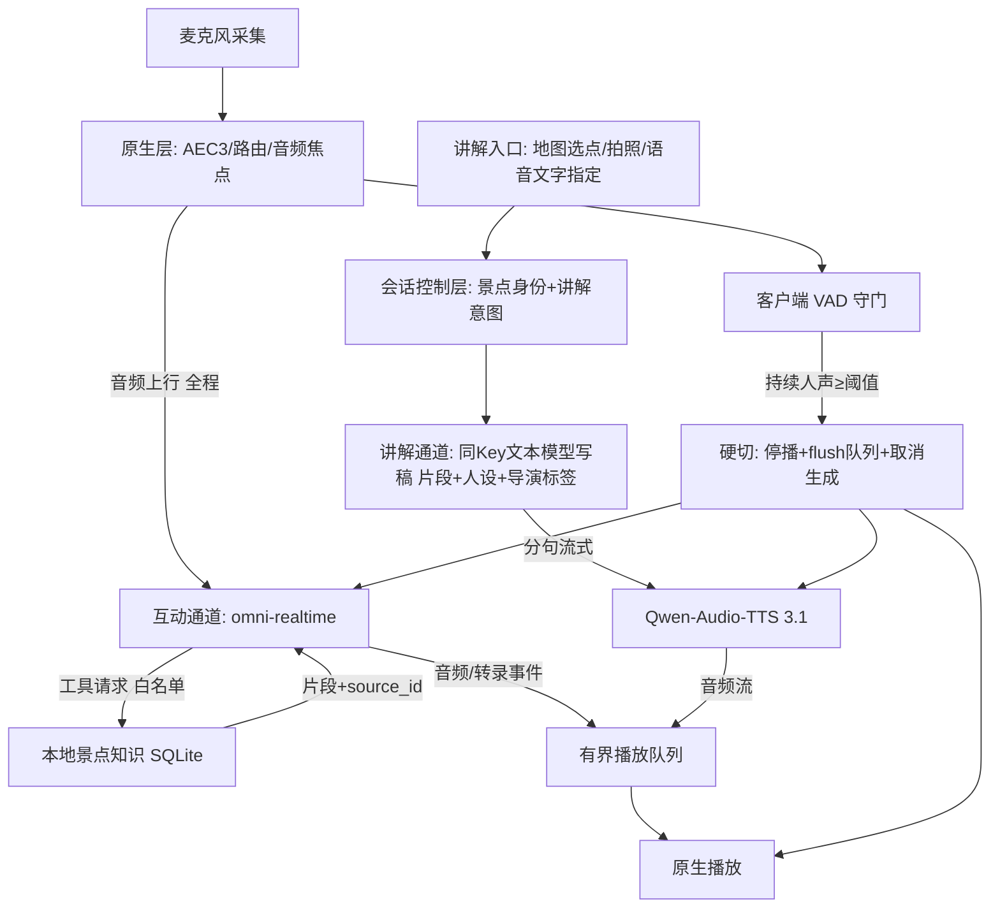
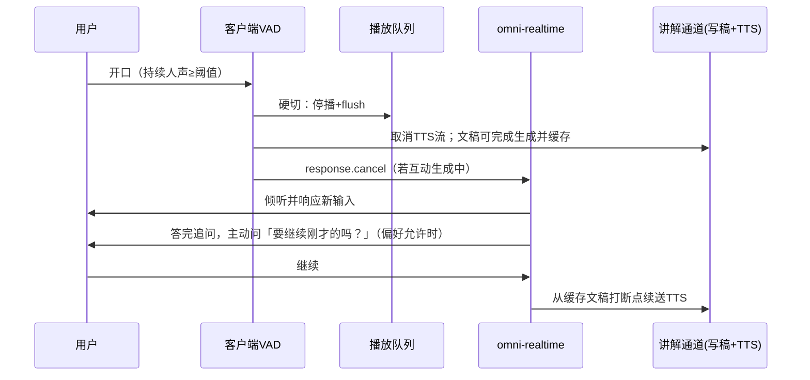

# 语音模块架构设计（VOICE.MD）

- 设计日期：2026-11-18
- 阶段：架构讨论共识，**尚未实现或实测**；所有数值目标待真机基线建立后确定
- 依据：handoff 续作讨论、四路网络调研（开源框架与表现力 TTS、跨领域打断方案、跨供应商实时能力、开源项目实战模型栈）、逐轮选项式问答与用户确认（Q1–Q16）
- 与 DESIGN.MD 的关系：本文档细化语音模块架构。**DESIGN.MD 本轮不修改**；需并入的变更见 §8 待修订清单，经用户复核后另行提交。本文档与 DESIGN 已确认决策冲突处，以 DESIGN 为准并标出待修订。
- 证据等级沿用 RESEARCH.MD §2.2：A=官方文档原文，B=搜索摘要/第三方，C=工程估算，未核实=集成前必须补证。

## 1. 决策记录（用户已确认）

| # | 决策 | 内容 | 主要依据 |
| --- | --- | --- | --- |
| D1 | 路线 | **混合双通道，百炼同 Key**：互动追问走端到端实时；长篇讲解走「文本模型写稿 → 表现力流式 TTS」 | 实战主流=级联+流式TTS+客户端VAD（小智/VTuber/HF）；端到端闸门最全=百炼 omni；副语言可控 TTS=Qwen-Audio-TTS（同平台同 Key） |
| D2 | 互动通道 | `qwen3.8-omni-flash-realtime`（首测候选，闸门后定版）：FC 工具回传、内置联网搜索、同会话图片输入、`response.cancel`+semantic_vad | 本轮官方文档核实（A）；内置搜索为 DESIGN/RESEARCH 原「未确认」项的更新 |
| D3 | 讲解通道 | 同 Key qwen-plus/flash 类文本模型实时写稿（知识片段+人设+导演标签）→ **Qwen-Audio-TTS 3.1** 朗读；指令控情感/语速 + 富语言标签 `[laughing]`/`[sighing]`/`[gasp]` | 百炼 TTS 官方指南（A）；**流式/增量合成能力待核实**（见 §7-E2） |
| D4 | 监听 | 讲解播放期间 omni 会话**全程保持监听**；AEC3 + 播放期提高 VAD 阈值防自触发 | 质量优先（D9）；打断后响应最快（上下文已在）；音频输入持续计费，护栏约束 |
| D5 | 活人感成分 | V1 = 韵律起伏 + 话语节奏 + 副语言 + 声线人格一致；**backchannel 留 V2** | 配音领域：内联 token 对 LLM 最友好（B）；backchannel 需全双工管线，复杂度/费用跳档 |
| D6 | 打断停止 | **全部硬切**：立即停播 + 清空待播队列 + 取消生成 | 用户裁决；DESIGN §3.6 现行红线保留；响应最快、实现最简 |
| D7 | 打断判定 | **客户端 VAD 守门**（持续人声粗过滤挡短附和）；服务端 VAD 管话轮语义；组件 **Silero vs earshot 真机对比后定** | 行业锚点：打断全链路 <200ms（B）；DESIGN「服务端 VAD 不能替代客户端停播」；Silero 为开源界事实标准（小智/VTuber/HF/Pipecat） |
| D8 | 音色 | 预置授权音色 1–2 个；跨通道**优先同一音色 ID，不共享则试听挑最接近**；具体音色试听+许可审计后定 | 声线权利独立于代码许可（RESEARCH §6.3）；DESIGN 禁止未授权真人克隆 |
| D9 | 成本 | 质量优先 + 用量护栏（会话时长上限/空闲断开/用量显示） | 用户裁决；DESIGN §8.3 |
| D10 | 延迟 | **数值全部实测后再定**，不设纸面目标/合格线 | 用户裁决；DESIGN §11.2「基线建立后确定」 |
| D11 | 打断后续讲 | 答完追问**主动问「要继续刚才的吗？」**；受「不喜欢主动提问」类偏好门控降级；进度复用「已讲主题」本地记忆 | 用户裁决；DESIGN §6.3 已讲进度字段，不新增隐私范围 |
| D12 | 实测范围 | 百炼双通道过 DESIGN §5.3 全闸门；豆包 Seeduplex / 阶跃 StepAudio-3 **只做拟人度试听对照**（阶跃限免至 2026-11-23） | 用户裁决；三人团队精力聚焦 |

## 2. 双通道架构

| 通道 | 职责 | 输入 | 输出 | 计费 |
| --- | --- | --- | --- | --- |
| 互动（端到端） | 追问、闲聊、工具回传、联网热点、图片辅助 | 麦克风音频（全程）、文字、单图 | 音频+转录文本 | 音频入 6 / 出 12，文本入 1.5 / 出 4.5（元/百万 Token，北京，2026-11-13 快照） |
| 讲解（级联） | 长篇景点讲解 | 知识片段+人设+偏好+导演标签 | 文稿（=屏幕文本）→ 音频 | 文本模型按 Token + TTS 按字符（单价待固定版本核实） |

**讲解触发不新增模型工具权限**：入口为地图选点、拍照触发、语音/文字指定；会话控制层从 omni 转录文本+本地规则判定讲解意图，歧义时走 DESIGN §3.3 候选确认。工具白名单保持 DESIGN §7.3 只读范围。

**状态机**：在 DESIGN §3.6 状态（未连接/连接中/倾听/检索中/生成播放/暂停/错误离线）基础上，「生成/播放」增加通道标记（互动/讲解），新增「续讲询问」子态。讲解播放期间互动会话保持打开（D4）。

## 3. 打断与续讲

- 硬切全链路（检测→停播→flush→取消）以行业锚点 <200ms 为工程参照，**实测后定目标**（D10）。
- 硬切可加 ≤50ms 去咔嗒淡出，不改变硬切语义（工程细节，非 graceful 收尾）。
- 短音白名单（嗯/对/ok，<300–500ms 且无新语义）不触发停播；完整 backchannel 语义区分留 V2。
- 打断时音频立即 flush，**文稿生成可完成并缓存**（文本成本低），供续讲；用户明确结束会话则丢弃缓存。
- 续讲进度复用「已讲主题」本地记忆（DESIGN §6.3），不新增隐私范围；主动询问受用户偏好门控（D11）。
- 实体停止按钮永远硬切并结束会话（DESIGN 现行）。

## 4. 音频管线与原生层

- 原生层（Kotlin/Swift 薄桥接）负责：AEC3（Android/iOS 原生采集链路）、耳机/蓝牙/扬声器路由、音频焦点、来电中断、后台状态（DESIGN §3.6 既定）。
- **播放期间提高 VAD 阈值**：AEC3 在外放+蓝牙场景仍会漏回声（B），软件层兜底防自触发；真机测试矩阵覆盖安静/风噪/人声/耳机/外放（DESIGN §11.1）。
- 麦克风音频全程上行 omni 会话（D4）；讲解播放期间亦然。音频输入持续计费 → 会话时长上限 + 用量显示护栏（D9）。
- 播放队列有界（DESIGN §7.3 防费用放大），上限实测后定。
- VAD 组件候选：Silero VAD（MIT，ONNX ~2MB，Pipecat/LiveKit/VTuber/HF 默认件）vs earshot（pykeio，Rust ~40KB no_std，包声明 MIT OR Apache-2.0，**权重许可未核验**，需 FFI/原生桥接）。真机对比误触发率/延迟/包体/电量后定（D7）。
- 失去网络：结束/暂停实时连接，保留本地文字阅读；恢复后询问是否继续，不无限重试、不无提示重新录音（DESIGN 现行）。

## 5. 表现力控制

- **讲解通道**：写稿 prompt 按风格预设插入导演标签（`[laughing]`/`[sighing]`/`[gasp]` 等）与停顿/重音/语速指令；标签频率上限 + 仅限已审核风格范围（DESIGN §7.3「变化仅在已审核风格和知识范围内」）。
- **事实与风格分离**：标签/人设不降低事实标准；文稿以授权知识片段为据，来源随屏幕文本展示（DESIGN §6.1/§7.3）。
- **互动通道**：副语言靠模型原生（instructions 引导风格），**尽力而为、不伪造**；指令级笑声/叹气控制未核实（§7-E6）。
- **音色一致**：先核实 omni-realtime 与 Qwen-Audio-TTS 音色目录是否共享 ID（未核实）；共享则同 ID，不共享则试听挑最接近，接受轻微差异；人格一致靠人设+文稿风格兜底（D8）。
- 声线商用许可单独审计；代码 Apache-2.0 不覆盖音色权利（RESEARCH §6.3）。V1 不做声音克隆。

## 6. 实现层约定（工程细节，不再单独裁决）

- 分句流式：文稿按句/段切分送 TTS，首句优先合成以降首包延迟；句界即天然打断点与进度标记。
- 讲解文稿即屏幕文本：天然可阅读/复制/来源展开（DESIGN §3.3）；互动转录按 DESIGN 文字同步口径。
- 降级：TTS 不可用 → 讲解降级为文字展示，互动通道仍可用；无网络 → 本地文字；不伪装已连接（DESIGN 现行）。
- 讲解期监听成本纳入用量显示；音频秒→Token 换算实测前不承诺每分钟价格（DESIGN §8.3）。
- 工具调用与当前会话/POI/响应 ID 对应，迟到结果不覆盖已切换景点（DESIGN §3.6 现行）。

## 7. 实验与实测留项（不做纸面决定）

| # | 项 | 方法 | 决策规则 |
| --- | --- | --- | --- |
| E1 | 两通道音色目录共享核实 + 试听 | 官方文档 + 真机试听 | 选定 1–2 预置授权音色（D8） |
| E2 | **Qwen-Audio-TTS 3.1 流式/增量能力与首包延迟** | 官方文档固定版本核实 + 实测 | 若不支持流式：分句合成顺序播放，或改同平台流式 TTS 并重新核实指令控制（候选 CosyVoice-v3-flash，指令支持范围需核实） |
| E3 | VAD 对比（Silero vs earshot） | 真机：误触发率/延迟/包体/电量 | 选定组件（D7）；固定版本许可审计后集成 |
| E4 | 百炼双通道全闸门 | DESIGN §5.3 八项 + 讲解通道标签效果/续讲/监听成本 | 通过后锁定默认模型快照与配置模板 |
| E5 | 豆包 Seeduplex / 阶跃 StepAudio-3 试听对照 | 短会话拟人度试听（阶跃限免至 2026-11-23） | 只作对照，不过全闸门（D12） |
| E6 | 互动通道副语言/韵律指令控制边界 | 官方文档 + 实测 | 明确「尽力而为」范围，不伪造能力 |
| E7 | 延迟基线 | 首包可听、打断全链路，中位数/P95 | 基线建立后定目标（D10） |
| E8 | 音频秒→Token 换算 + 护栏数值 | 实测账单/用量事件 | 会话时长上限、空闲断开、队列上限数值 |
| E9 | 固定版本许可审计 | 模型权重/音色/SDK/依赖原始 LICENSE | 发布前阻断项（RESEARCH §10.3） |

## 8. DESIGN.MD 待修订清单（本轮不应用，经用户复核后并入）

| DESIGN 位置 | 变更 | 原因 |
| --- | --- | --- |
| §5.1/§5.2 | 串联从「失败后备选」升为「讲解通道」；互动仍端到端 | D1 混合路线 |
| §5.1/RESEARCH §6.2 | 内置联网搜索由「未确认」更新为「官方证实（A）」 | 本轮调研 |
| §3.6 | 加讲解通道、续讲询问子态、讲解期全程监听 | D1/D4/D11 |
| §5.3 | 闸门增加讲解通道项（标签效果、流式能力、续讲、监听成本） | D3/E2/E4 |
| §6.3 | 「已讲主题」进度复用为续讲打断点说明 | D11 |
| §8.3 | 成本公式加「讲解期音频输入持续计费」项 | D4 |
| §10.2 V2 | backchannel、语义级打断、声音克隆候选保持 V2+ | D5/D8 |

## 9. 证据与来源（本轮调研，等级标注）

**供应商能力（A=官方文档，B=摘要/第三方）**

- 百炼 omni-realtime：FC/内置搜索/图片输入/取消+semantic_vad（A）；[实时文档](https://help.aliyun.com/zh/model-studio/realtime)、[Function Calling](https://help.aliyun.com/zh/model-studio/qwen-function-calling)
- 百炼 Qwen-Audio-TTS 3.0/3.1：指令控情感/语速 + 富语言标签（A，[非实时 TTS 指南](https://help.aliyun.com/zh/model-studio/non-realtime-tts-user-guide)）；**流式能力待核实（E2）**
- 豆包 Seeduplex：FC/取消/instructions 风格（A，[文档](https://docs.volcengine.com/docs/doubao-voice/end-to-end-real-time-voice-full-duplex-version?lang=zh)）；音频出 ~300 元/百万 Token（B，控制台复核）；副语言指令控制/音色商用授权**未核实**
- 阶跃 StepAudio-3-Realtime：FC function/retrieval（A，[文档](https://platform.stepfun.com/docs/zh/guides/models/stepaudio-3-realtime)）；限免至 2026-11-23、之后 0.65 元/会话分钟（A，[定价](https://platform.stepfun.com/docs/zh/guides/pricing/details)）
- 智谱 GLM-Realtime：FC 仅语音通话模式、Flash 0.18 元/分、视频输入（A，[文档](https://docs.bigmodel.cn/cn/guide/models/sound-and-video/glm-realtime)）；表现力控制未核实
- MiniMax Realtime：2026 官方文档目录无条目，现状存疑，**不押注**；TTS emotion 枚举（B 镜像）vs 官方仅 speed/vol/pitch（A）
- 讯飞：FC 未核实 + 套餐制，BYOK 门槛高，排除；Gemini/OpenAI：大陆不可直连，仅参照

**开源实战（B 为主，GitHub 直连受限经镜像/摘要）**

- 小智 xiaozhi-esp32-server（~11.3k★）：SenseVoice+Qwen+豆包TTS/CosyVoice，客户端 VAD+服务端状态机打断；官方云 Qwen 72B（A，[FAQ](https://xiaozhi.me/xz-docs/docs/help-doc/xiaozhi-ai-chatbot-q&a/)）——**数十万级设备跑级联，非端到端**
- Open-LLM-VTuber：前端 Silero-VAD 打断（A，[v1.1.0](https://open-llm-vtuber.github.io/blog/v1.1.0-release)）；TTS 默认 sherpa-onnx（A，[文档](https://docs.llmvtuber.com/en/docs/user-guide/backend/tts/)）；中文社区偏好 CosyVoice2/GPT-SoVITS（B）
- HF speech-to-speech：Silero VAD→Parakeet→Qwen LLM→Qwen3-TTS（B）
- Pipecat BSD-2 / LiveKit Agents Apache-2.0（轮检测模型单独许可且绑定 LiveKit）；**TEN Framework 许可禁止部署到终端用户设备，移动 App 排除**
- 表现力 TTS 许可雷区：ChatTTS/F5-TTS/Fish Speech/Spark-TTS/Higgs Audio 新版权重**不可直接商用**；IndexTTS-2 商用需登记+书面授权；CosyVoice 权重 Apache-2.0（音色权利另计）

**跨领域锚点（B）**

- 打断全链路 <200ms（[RunEdge](https://www.runedge.ai/blog/barge-in-interruption-handling-on-device-voice)）；AEC3 事实标准、外放/蓝牙漏回声需阈值兜底（[Coval](https://www.coval.ai/blog/voice-ai-echo-cancellation/)）
- backchannel 白名单 <300–500ms + 语义双层判定（[Evalgent](https://www.evalgent.com/resources/guides/barge-in-voice-agents)）
- 内联 paralinguistic token 对 LLM 最友好，纯 SSML 出错率高（[Higgs 控制 token](https://huggingface.co/bosonai/higgs-tts-3-4b)、[Azure SSML](https://learn.microsoft.com/en-us/azure/ai-services/speech-service/speech-synthesis-markup-voice)）
- 人类话轮间隙众数 0–200ms（[Stivers PNAS](https://www.pnas.org/doi/10.1073/pnas.0903616106)）；游戏虚拟人淡出/ducking 100–200ms（[Convai](https://convai.com/blog/real-time-ai-conversations-facial-animation-metahuman-unreal-engine-convai)）——本设计取硬切+≤50ms 去咔嗒，不取 graceful

**调研出入说明**：两轮调研对 CosyVoice-v2 指令控制说法不一（一轮称支持，本轮官方文档核查未提及，v3 系列仅复刻/设计音色支持指令）。以固定版本官方文档为准（E2/E9）；当前证据指向 Qwen-Audio-TTS 3.1 为讲解通道首选。Earshot 同名项目三个（pykeio VAD、通话可观测性、coding agent 听觉），均非情感 TTS/对话框架；本设计仅 pykeio VAD 作候选。

## 10. V1/V2 边界与合规

- **V1**：混合双通道、硬切打断、客户端 VAD、预置授权音色、导演标签副语言、续讲询问、用量护栏。
- **V2+**：backchannel、语义级打断/误打断恢复、声音克隆（需单独权利审查）、离线音频缓存、多音色。
- 合规沿用 DESIGN §7.5：V1 团队内部验证，非公众上线承诺；AI 生成音频显式/隐式标识（标识办法 2025-09-01 施行）不得为「真人感」去除；拟人化互动办法（2026-07-15 施行）适用范围按实际功能评估；不声称已实现未实测能力。